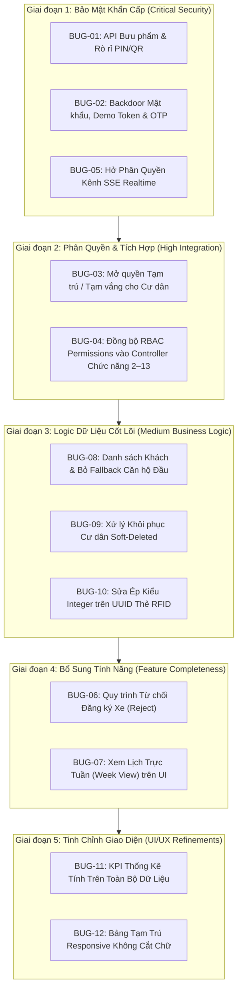

# KẾ HOẠCH KHẮC PHỤC 12 BUG ĐÃ XÁC MINH (BUG_FIX_PLAN)
**Dự án**: `UMISORA09/QUANLY_TOANHA-DANCU`  
**Nhánh thực hiện**: `QuocTin/Fix_all`  
**Ngày lập kế hoạch**: 2026-10-30  
**Tình trạng tài liệu**: BẢN THẢO KẾ HOẠCH CHỜ PHÊ DUYỆT (CHƯA THỰC HIỆN SỬA CODE)

---

## I. NGUYÊN TẮC THỰC HIỆN & RÀNG BUỘC AN TOÀN

1. **Nguyên tắc can thiệp tối thiểu (Minimal Invasive / Surgical Fix)**: Chỉ chỉnh sửa đúng các dòng code gây ra lỗi logic hoặc lỗ hổng bảo mật. Không tái cấu trúc (refactor), không đổi tên hàm công khai, không xóa code không liên quan của các thành viên khác.
2. **Bảo vệ tuyệt đối hệ thống cốt lõi**: Không thay đổi cơ chế sinh Session, cấu trúc JWT Bearer Token, cơ chế băm mật khẩu `Hash::make()` (bcrypt), hoặc kiến trúc bảng `users`, `user_sessions`, `roles`, `permissions`.
3. **Bảo toàn Database Schema**: Không thay đổi cấu trúc bảng hoặc thêm migration mới trừ trường hợp bắt buộc đã chứng minh không thể xử lý bằng code ứng dụng (đặc biệt đối với BUG-06).
4. **Chia giai đoạn độc lập (Phased Approach)**: Khắc phục theo thứ tự ưu tiên bảo mật -> tích hợp phân quyền -> logic dữ liệu -> tính năng -> giao diện. Mỗi BUG được kiểm tra và nghiệm thu độc lập trước khi chuyển sang BUG tiếp theo.
5. **Kiểm thử hồi quy liên tục (Regression Safety)**: Sau mỗi thay đổi, chạy bộ test tự động tương ứng trên database kiểm thử độc lập `quanly_toanha_test`, bảo đảm 296 test case hiện có không bị gãy (zero regression).

---

## II. LỘ TRÌNH THỰC HIỆN THEO GIAI ĐOẠN



---

## III. KẾ HOẠCH KHẮC PHỤC CHI TIẾT TỪNG BUG

---

### GIAI ĐOẠN 1: BẢO MẬT KHẨN CẤP (CRITICAL SECURITY)

#### 1. BUG-01 – Bảo Mật API Bưu Phẩm & Rò Rỉ PIN/QR (Chức năng 9 & 11)

- **A. Nguyên nhân chính xác**:
  - `routes/web.php` (dòng 219–231) chỉ gắn `middleware('auth.bearer')` cho 3 route bàn giao, bỏ ngỏ 10 route bưu phẩm không có xác thực.
  - `ReceptionParcelService::receiveParcel()` (dòng 259–269) khi `$staffUser === null` tự động lấy user đầu tiên trong DB làm người tiếp nhận, cho phép người dùng nặc danh tạo bưu phẩm.
  - `ReceptionParcelService::getParcels()` không ràng buộc `apartment_id` khi người gọi là cư dân; đồng thời `ResidentParcelWidget.tsx` (dòng 99–103) gọi lấy danh sách bưu phẩm toàn tòa nhà hiển thị cả `pickup_pin_code` và `pickup_qr_code`.
- **B. File và hàm cần thay đổi**:
  1. `routes/web.php`: Nhóm các route `/api/v1/reception/parcels*` vào `Route::middleware('auth.bearer')`.
  2. `app/Http/Controllers/ReceptionParcelController.php`: Bổ sung kiểm tra `$staffUser = $request->user();` trong các action quản trị (`store`, `update`, `destroy`, `lookup`, `remind`, `searchRecipients`, `searchApartments`).
  3. `app/Services/ReceptionParcelService.php`:
     - Trong `receiveParcel()`: Xóa bỏ khối fallback tự động lấy `User::whereHas(...)->value('id')`. Ném `AuthenticationException` nếu `$staffId` rỗng.
     - Trong `getParcels()`: Kiểm tra nếu user có vai trò `RESIDENT*` (không có role nhân viên), bắt buộc áp dụng `whereIn('apartment_id', $userApartmentIds)`.
  4. `resources/js/Components/ResidentParcelWidget.tsx`: Truyền rõ `apartment_id` của cư dân khi gọi API.
- **C. Những file tuyệt đối không cần thay đổi**:
  - Không sửa `app/Models/Parcel.php`.
  - Không sửa các bảng cơ sở dữ liệu `parcels`.
  - Không sửa `app/Jobs/SendParcelNotificationJob.php`.
- **D. Phương án sửa tối thiểu (Minimal Diff)**:
  - Bọc nhóm route trong `routes/web.php` bằng `Route::prefix('api/v1/reception/parcels')->middleware('auth.bearer')->group(...)`.
  - Trong `ReceptionParcelService::receiveParcel()`, thay 11 dòng fallback bằng:
    ```php
    $staffId = $staffUser?->id;
    if (! $staffId) {
        throw new AuthenticationException('Yêu cầu xác thực tài khoản nhân viên để tiếp nhận bưu phẩm.');
    }
    ```
- **E. Các chức năng có nguy cơ bị ảnh hưởng**:
  - Cổng thông tin Cư dân (`ResidentParcelWidget`): Nếu không truyền đúng `apartment_id`, widget sẽ rỗng.
  - Giao diện tiếp nhận bưu phẩm Lễ tân (`ReceptionParcelPanel`): Cần đảm bảo axios request luôn gửi Bearer token trong header.
- **F. Các trường hợp kiểm thử trước và sau khi sửa**:
  - *Pre-fix test*: Gọi `POST /api/v1/reception/parcels` không có header `Authorization` -> Nhận `201 Created` (lỗ hổng).
  - *Post-fix test 1*: Gọi `POST /api/v1/reception/parcels` không có token -> Phải nhận `401 Unauthorized`.
  - *Post-fix test 2*: Đăng nhập tài khoản cư dân căn hộ A, gọi `GET /api/v1/reception/parcels` -> Chỉ nhận bưu phẩm thuộc căn hộ A, không thấy bưu phẩm căn hộ B.
  - *Post-fix test 3*: Đăng nhập tài khoản lễ tân, gọi tiếp nhận và bàn giao bưu phẩm -> Hoạt động bình thường.
  - *Chạy lại bộ test*: `vendor/bin/phpunit tests/Feature/ReceptionParcel/ReceptionParcelTest.php tests/Feature/ReceptionParcel/ReceptionParcelCheckoutTest.php`.
- **G. Điều kiện xác nhận lỗi đã được khắc phục**:
  - Không thể đọc hoặc can thiệp bưu phẩm nếu không có token. Cư dân không bao giờ đọc được mã PIN/QR của căn hộ khác. Toàn bộ 30 test case bưu phẩm đạt PASS.

---

#### 2. BUG-02 – Bảo Mật Đăng Nhập, Demo Token & Mã OTP (Chức năng 1, 4 & 13)

- **A. Nguyên nhân chính xác**:
  - `AuthController::login()` (dòng 139–142) chứa mảng `$demoFallbacks` kiểm tra mật khẩu cứng cho 10 tài khoản hệ thống mà không bọc điều kiện `app()->environment('local', 'testing')`.
  - `AuthController::sendRegisterOtp()` (dòng 411) trả về `'debug_otp' => $otp` vô điều kiện trong response JSON.
  - `ReceptionDashboardController::resolveAuthUser()` (dòng 26–33) chấp nhận 3 demo token cứng mà không kiểm tra môi trường.
- **B. File và hàm cần thay đổi**:
  1. `app/Http/Controllers/AuthController.php`:
     - Trong `login()`: Bọc `$isDemoFallbackPass` bằng `if (app()->environment('local', 'testing'))`.
     - Trong `sendRegisterOtp()`: Đổi `'debug_otp' => app()->environment('local', 'testing') ? $otp : null`.
  2. `app/Http/Controllers/ReceptionDashboardController.php`:
     - Trong `resolveAuthUser()`: Bọc điều kiện kiểm tra demo token bằng `if (app()->environment('local', 'testing'))`.
- **C. Những file tuyệt đối không cần thay đổi**:
  - Không sửa `AuthenticateBearer.php` (middleware này đã có sẵn kiểm tra môi trường chuẩn).
  - Không sửa hàm băm mật khẩu, không sửa hàm xác thực JWT/Token trong `user_sessions`.
  - Không sửa bảng `users` hay seeders.
- **D. Phương án sửa tối thiểu (Minimal Diff)**:
  - Trong `AuthController.php`:
    ```php
    $isDemoFallbackPass = app()->environment('local', 'testing')
        && in_array($user->username, ['admin', 'manager', 'receptionist', 'security', 'resident.owner', 'resident.member', 'accountant', 'nguyenvanan', 'quanly', 'letan'], true)
        && in_array($password, ['123567', '123456', 'Admin@123456', 'Manager@123456', 'Receptionist@123456', 'Security@123456', 'Resident@123456', 'Accountant@123456'], true);
    ```
  - Trong `ReceptionDashboardController.php`:
    ```php
    if (! $user && app()->environment('local', 'testing')) {
        $bearer = $request->bearerToken();
        ...
    }
    ```
- **E. Các chức năng có nguy cơ bị ảnh hưởng**:
  - Đăng nhập tài khoản thật của hệ thống: Đảm bảo không ảnh hưởng đến luồng `Hash::check($password, $user->password_hash)`.
  - Các bài kiểm thử PHPUnit: Đảm bảo trong `phpunit.xml` có `<env name="APP_ENV" value="testing"/>` để các test case dùng demo token/demo pass vẫn chạy thông suốt.
- **F. Các trường hợp kiểm thử trước và sau khi sửa**:
  - *Pre-fix test*: Giả lập `APP_ENV=production`, gọi đăng nhập `admin` với pass `Admin@123456` khi hash trong DB khác pass này -> Đăng nhập thành công (lỗ hổng).
  - *Post-fix test 1*: Ở môi trường production, đăng nhập với mật khẩu demo -> Nhận `401 Unauthorized`.
  - *Post-fix test 2*: Đăng nhập bằng mật khẩu thực đã mã hóa trong DB -> Nhận `200 OK` kèm token.
  - *Post-fix test 3*: Gọi `POST /api/v1/auth/send-register-otp` ở production -> Response không có trường `debug_otp`.
  - *Post-fix test 4*: Ở môi trường testing, chạy toàn bộ test auth: `vendor/bin/phpunit tests/Feature/AuthSecurityRegressionTest.php tests/Feature/ReceptionDashboard/ReceptionDashboardTest.php`.
- **G. Điều kiện xác nhận lỗi đã được khắc phục**:
  - Trên production không thể dùng mật khẩu demo hoặc demo token để truy cập. Không lộ OTP trong response JSON.

---

#### 3. BUG-05 – Phân Quyền Các Kênh SSE Realtime Stream (Chức năng 6, 7, 8, 9, 11, 12)

- **A. Nguyên nhân chính xác**:
  - `QuocTinRealtimeService::isUserAuthorizedForChannel()` (dòng 197–208) nối thêm `|| true` cho kênh `quoc-tin.rfid-cards`, và gán cứng `=> true` cho `quoc-tin.visitors`, `quoc-tin.parcels`, `quoc-tin.schedules`, khiến mọi tài khoản đã đăng nhập đều nghe được sự kiện của toàn tòa nhà.
- **B. File và hàm cần thay đổi**:
  - `app/Services/QuocTinRealtimeService.php`: Trong hàm `isUserAuthorizedForChannel()`.
- **C. Những file tuyệt đối không cần thay đổi**:
  - Không sửa `app/Http/Controllers/RealtimeStreamController.php`.
  - Không sửa client hook `resources/js/Hooks/useRealtimeSync.ts`.
  - Không sửa Redis pub/sub driver.
- **D. Phương án sửa tối thiểu (Minimal Diff)**:
  - Xóa bỏ `|| true` ở kênh thẻ RFID.
  - Kênh `quoc-tin.schedules`: Chỉ cho phép nhân viên vận hành (`SUPER_ADMIN`, `ADMIN`, `BUILDING_MANAGER`, `RECEPTIONIST`, `SECURITY_GUARD`, `TECHNICIAN`).
  - Kênh `quoc-tin.visitors` và `quoc-tin.parcels`: Nhân viên được nghe toàn bộ; Cư dân (`RESIDENT*`) chỉ được nghe nếu đăng ký lắng nghe có phạm vi căn hộ hoặc cho phép kết nối nhưng lọc payload không phát broadcast thông tin nhạy cảm (như mã PIN bưu phẩm).
- **E. Các chức năng có nguy cơ bị ảnh hưởng**:
  - Cập nhật realtime trên trang quản lý RFID, Lịch trực, Bưu phẩm, Khách thăm: Đảm bảo các role nhân viên hợp lệ vẫn nhận được sự kiện bình thường.
- **F. Các trường hợp kiểm thử trước và sau khi sửa**:
  - *Pre-fix test*: Dùng token cư dân gọi `GET /api/realtime/stream?channels=quoc-tin.rfid-cards,quoc-tin.schedules` -> Nhận `200 text/event-stream` (lỗ hổng).
  - *Post-fix test 1*: Dùng token cư dân yêu cầu kênh `quoc-tin.rfid-cards` hoặc `quoc-tin.schedules` -> Kênh bị loại khỏi danh sách authorized channels (hoặc từ chối nếu không có kênh hợp lệ).
  - *Post-fix test 2*: Dùng token lễ tân yêu cầu 2 kênh trên -> Kết nối thành công và nhận sự kiện.
  - *Chạy lại bộ test*: `vendor/bin/phpunit tests/Feature/RealtimeSyncTest.php`.
- **G. Điều kiện xác nhận lỗi đã được khắc phục**:
  - Cư dân không thể nghe trộm các kênh vận hành nội bộ (thẻ RFID, lịch trực). Các bài test `RealtimeSyncTest` đạt PASS 100%.

---

### GIAI ĐOẠN 2: PHÂN QUYỀN & TÍCH HỢP LIÊN CHỨC NĂNG (HIGH INTEGRATION)

#### 4. BUG-03 – Mở Quyền Đăng Ký Tạm Trú / Tạm Vắng Cho Cư Dân (Chức năng 3)

- **A. Nguyên nhân chính xác**:
  - `TemporaryRegistrationRequest::authorize()` (dòng 15–31) và `TemporaryRegistrationController::checkAdminAuthorization()` (dòng 25–44) giới hạn cứng chỉ cho `SUPER_ADMIN` và `BUILDING_MANAGER`, chặn đứng toàn bộ cư dân (`RESIDENT*`) với mã lỗi 403.
- **B. File và hàm cần thay đổi**:
  1. `app/Http/Requests/TemporaryRegistrationRequest.php`: Hàm `authorize()`.
  2. `app/Http/Controllers/TemporaryRegistrationController.php`: Tách biệt logic kiểm tra quyền giữa nhóm hành động "Khai báo/Xem của Cư dân" và nhóm hành động "Duyệt của Ban quản lý".
  3. `app/Services/TemporaryRegistrationService.php`: Trong `listRegistrations()` và `createRegistration()`, nếu người gọi là Cư dân, tự động ép `resident_id` và `apartment_id` theo đúng tài khoản của cư dân đó.
- **C. Những file tuyệt đối không cần thay đổi**:
  - Không sửa logic xuất biểu mẫu CT01 (`exportForm`, `downloadForm`).
  - Không sửa các trạng thái xử lý Công an (`submitToPolice`).
  - Không sửa bảng `temporary_registrations`.
- **D. Phương án sửa tối thiểu (Minimal Diff)**:
  - Trong `TemporaryRegistrationRequest::authorize()`: Cho phép nếu là Admin HOẶC nếu người dùng có role `RESIDENT`, `RESIDENT_OWNER`, `RESIDENT_MEMBER` (hoặc có quyền `TEMP_REG:CREATE`).
  - Trong `TemporaryRegistrationController`:
    - Với `store`, `index`, `show`, `exportForm`, `downloadForm`: Cho phép Cư dân truy cập dữ liệu của chính mình.
    - Với `approve`, `reject`, `submitToPolice`: Giữ nguyên kiểm tra nghiêm ngặt `checkAdminAuthorization()`.
- **E. Các chức năng có nguy cơ bị ảnh hưởng**:
  - Trang quản trị Ban quản lý (`TemporaryRegistrationManagement.tsx`): Vẫn xem và duyệt tất cả hồ sơ như cũ.
  - Cần bảo đảm cư dân không thể xem trộm hồ sơ tạm trú của căn hộ khác.
- **F. Các trường hợp kiểm thử trước và sau khi sửa**:
  - *Pre-fix test*: Cư dân gọi `POST /api/v1/residents/temporary-registrations` -> Nhận `403 Forbidden` (lỗi tích hợp #1).
  - *Post-fix test 1*: Cư dân tạo hồ sơ tạm trú cho chính mình -> Nhận `201 Created`.
  - *Post-fix test 2*: Cư dân cố tình tạo hồ sơ cho căn hộ khác -> Bị từ chối `403 Forbidden` hoặc `422 Unprocessable`.
  - *Post-fix test 3*: Cư dân cố gọi `POST .../{id}/approve` -> Bị từ chối `403 Forbidden`.
  - *Post-fix test 4*: Admin duyệt hồ sơ cư dân vừa tạo -> Nhận `200 OK`.
  - *Chạy lại bộ test*: `vendor/bin/phpunit tests/Feature/TemporaryRegistrations/TemporaryRegistrationTest.php tests/Feature/TemporaryRegistrations/TemporaryRegistrationUpdateDeleteTest.php`.
- **G. Điều kiện xác nhận lỗi đã được khắc phục**:
  - Cư dân tạo và xem được hồ sơ tạm trú/tạm vắng của căn hộ mình. Ban quản lý duyệt bình thường. Đạt yêu cầu tích hợp liên chức năng số 1.

---

#### 5. BUG-04 – Đồng Bộ RBAC Matrix Permissions Vào Controller Nghiệp Vụ (Chức năng 1 & 2–13)

- **A. Nguyên nhân chính xác**:
  - Các controller `ResidentController`, `TemporaryRegistrationController`, `AccountProvisioningController`, `VehicleController`, `AccessCardController`, `StaffScheduleController` chỉ kiểm tra cứng `hasRole([...])`. Nếu Admin thu hồi hoặc cấp quyền riêng qua RBAC Matrix (`role_permissions` hoặc `CUSTOM_USER_{ID}`), các controller không nhận biết và không tuân thủ.
- **B. File và hàm cần thay đổi**:
  1. `app/Http/Controllers/ResidentController.php`: `checkAdminAuthorization()`.
  2. `app/Http/Controllers/TemporaryRegistrationController.php`: `checkAdminAuthorization()`.
  3. `app/Http/Controllers/AccountProvisioningController.php`: `checkAdminAuthorization()`.
  4. `app/Http/Controllers/VehicleController.php`: `checkAdminAuthorization()`.
  5. `app/Http/Controllers/AccessCardController.php`: `checkAdminAuthorization()`.
  6. `app/Http/Controllers/StaffScheduleController.php`: `resolveAuthenticatedUser()`.
- **C. Những file tuyệt đối không cần thay đổi**:
  - Không sửa `app/Services/RbacService.php` (dịch vụ này đã có sẵn `hasPermission()`).
  - Không sửa `app/Models/User.php` (hàm `hasPermission()` đã hoạt động tốt).
  - Không sửa bảng `roles`, `permissions`, `role_permissions`.
- **D. Phương án sửa tối thiểu (Minimal Diff)**:
  - Thay vì chỉ kiểm tra `hasRole(['SUPER_ADMIN', 'BUILDING_MANAGER'])`, cập nhật hàm kiểm tra ủy quyền để xét:
    ```php
    // SUPER_ADMIN luôn có quyền tối cao
    if ($user->isSuperAdmin()) return null;

    // Kiểm tra quyền cụ thể từ RBAC Matrix hoặc quyền người đặc biệt
    if ($user->hasPermission($requiredPermission) || $user->hasPermission('SYSTEM:SPECIAL')) {
        return null;
    }

    // Nếu vai trò có quyền mặc định nhưng không bị thu hồi tường minh
    if ($user->hasRole(['SUPER_ADMIN', 'BUILDING_MANAGER']) && ! $user->hasExplicitlyDeniedPermission($requiredPermission)) {
        return null;
    }
    ```
  - Trong mỗi action (`store` -> `:CREATE`, `update` -> `:UPDATE`, `destroy` -> `:DELETE`, `index` -> `:VIEW`), truyền mã permission tương ứng vào hàm kiểm tra.
- **E. Các chức năng có nguy cơ bị ảnh hưởng**:
  - Tất cả các trang quản trị Admin nếu tài khoản đang đăng nhập thiếu quyền trong DB. Cần đảm bảo tài khoản test và seeders có đầy đủ permissions mặc định.
- **F. Các trường hợp kiểm thử trước và sau khi sửa**:
  - *Pre-fix test*: Thu hồi `RESIDENT:DELETE` của `BUILDING_MANAGER`, dùng tài khoản đó gọi `DELETE /api/v1/residents/{id}` -> Vẫn xóa được (lỗi).
  - *Post-fix test 1*: Thu hồi `RESIDENT:DELETE` -> Gọi API xóa cư dân bị chặn `403 Forbidden`.
  - *Post-fix test 2*: Cấp quyền `VEHICLE:VIEW` cho tài khoản Kế toán (`ACCOUNTANT`) -> Tài khoản đó xem được danh sách xe (`200 OK`).
  - *Post-fix test 3*: Tài khoản `SUPER_ADMIN` luôn thực hiện được mọi thao tác.
  - *Chạy lại bộ test*: `vendor/bin/phpunit tests/Feature/Rbac/RbacManagementTest.php tests/Feature/RbacSecurityTest.php`.
- **G. Điều kiện xác nhận lỗi đã được khắc phục**:
  - Cấu hình bật/tắt quyền trên RBAC Matrix có hiệu lực ngay lập tức khi gọi API trực tiếp. Đạt yêu cầu tích hợp liên chức năng số 10.

---

### GIAI ĐOẠN 3: LOGIC DỮ LIỆU CỐT LÕI (MEDIUM BUSINESS LOGIC)

#### 6. BUG-08 – Sửa Lọc Danh Sách Khách & Bỏ Fallback Căn Hộ Đầu Tiên (Chức năng 7)

- **A. Nguyên nhân chính xác**:
  - `ResidentVisitorService::listVisitors()` (dòng 45–75) dùng biến `$hasOwn`: nếu user đã từng tạo khách thì chỉ lọc theo `host_resident_user_id`, làm ẩn khách của các thành viên khác trong cùng căn hộ.
  - `ResidentVisitorService::createVisitor()` (dòng 269–273) nếu user chưa có căn hộ thì fallback lấy `DB::table('apartments')->first()`, gán khách vào căn hộ của người khác.
- **B. File và hàm cần thay đổi**:
  - `app/Services/ResidentVisitorService.php`: Hàm `listVisitors()` và `createVisitor()`.
- **C. Những file tuyệt đối không cần thay đổi**:
  - Không sửa `ResidentVisitorController.php`.
  - Không sửa bảng `visitor_registrations`.
  - Không sửa component `ResidentVisitorRegistrationPanel.tsx`.
- **D. Phương án sửa tối thiểu (Minimal Diff)**:
  - Trong `listVisitors()`: Bỏ nhánh `$hasOwn`, đồng nhất điều kiện lọc:
    ```php
    $apartmentIds = $this->resolveUserApartmentIds($user);
    if (! empty($apartmentIds)) {
        $q->where(function ($sub) use ($userId, $apartmentIds) {
            $sub->whereIn('visitor_registrations.apartment_id', $apartmentIds)
                ->orWhere('visitor_registrations.host_resident_user_id', $userId);
        });
    } else {
        $q->where('visitor_registrations.host_resident_user_id', $userId);
    }
    ```
  - Trong `createVisitor()`: Xóa bỏ dòng fallback `DB::table('apartments')->first()`. Thay bằng:
    ```php
    if (! $apartmentId) {
        throw ValidationException::withMessages([
            'apartment_id' => 'Tài khoản của bạn chưa được liên kết với bất kỳ căn hộ nào để đăng ký khách.',
        ]);
    }
    ```
- **E. Các chức năng có nguy cơ bị ảnh hưởng**:
  - Màn hình quản lý khách của cư dân: Các thành viên trong nhà sẽ thấy danh sách khách chung của căn hộ (đúng nghiệp vụ gia đình).
- **F. Các trường hợp kiểm thử trước và sau khi sửa**:
  - *Pre-fix test 1*: User A và User B cùng căn hộ; khi User B tạo khách thì khách của User A biến mất khỏi màn hình User B (lỗi).
  - *Pre-fix test 2*: Tạo user mới toanh chưa gán căn hộ, gọi tạo khách -> Khách bị gán vào căn hộ đầu tiên trong tòa nhà (lỗi).
  - *Post-fix test 1*: Cả User A và User B đều nhìn thấy đầy đủ khách của căn hộ mình.
  - *Post-fix test 2*: User chưa có căn hộ gọi tạo khách -> Nhận lỗi `422 Unprocessable Entity` rõ ràng.
  - *Chạy lại bộ test*: `vendor/bin/phpunit tests/Feature/ResidentVisitor/ResidentVisitorTest.php`.
- **G. Điều kiện xác nhận lỗi đã được khắc phục**:
  - Toàn bộ 16 test case trong `ResidentVisitorTest` đạt PASS. Dữ liệu căn hộ được bảo đảm toàn vẹn.

---

#### 7. BUG-09 – Xử Lý Khôi Phục Cư Dân Đã Bị Xóa Mềm Tránh Lỗi 1062 / 500 (Chức năng 2)

- **A. Nguyên nhân chính xác**:
  - Bảng `residents` có unique index `uq_resident_apt (user_id, apartment_id)`. Khi cư dân bị xóa mềm (`deleted_at IS NOT NULL`), index vẫn bị chiếm giữ. Khi admin thêm lại user đó vào căn hộ cũ, câu kiểm tra `whereNull('deleted_at')` bỏ qua bản ghi cũ, lệnh `Resident::create()` đụng lỗi MySQL 1062 và ném `ResidentConflictException` (HTTP 500/409).
- **B. File và hàm cần thay đổi**:
  - `app/Services/ResidentService.php`: Hàm `create()`.
- **C. Những file tuyệt đối không cần thay đổi**:
  - **Tuyệt đối không chạy migration xóa hoặc sửa unique index `uq_resident_apt`** (giữ nguyên index để bảo vệ dữ liệu chống race condition).
  - Không sửa `ResidentController.php` hay `ResidentRequest.php`.
- **D. Phương án sửa tối thiểu (Minimal Diff)**:
  - Trong `ResidentService::create()` ngay bên trong transaction:
    ```php
    // Kiểm tra xem đã từng có bản ghi cư dân bị xóa mềm ở căn hộ này chưa
    $trashedResident = Resident::onlyTrashed()
        ->where('user_id', $data['user_id'])
        ->where('apartment_id', $apartmentId)
        ->lockForUpdate()
        ->first();

    if ($trashedResident) {
        $trashedResident->restore();
        $trashedResident->update($data);
        $res = $trashedResident;
    } else {
        $res = Resident::create($data);
    }
    ```
- **E. Các chức năng có nguy cơ bị ảnh hưởng**:
  - Chức năng thêm cư dân mới: Không ảnh hưởng vì bản ghi mới hoàn toàn vẫn chạy qua nhánh `Resident::create($data)`.
  - Lịch sử cư dân: Được bảo toàn và kích hoạt lại đúng bản ghi cũ.
- **F. Các trường hợp kiểm thử trước và sau khi sửa**:
  - *Pre-fix test*: Chạy `test_case_14_soft_deleted_resident_behavior` trong `ResidentCreateTest.php` -> Nhận `500 Internal Server Error` (lỗi).
  - *Post-fix test*: Chạy lại test case 14 -> Nhận `201 Created` hoặc `200 OK`, bản ghi được restore thành công, không còn lỗi 1062 Duplicate entry.
  - *Chạy lại bộ test*: `vendor/bin/phpunit tests/Feature/Residents/ResidentCreateTest.php tests/Feature/Residents/ResidentManagementTest.php`.
- **G. Điều kiện xác nhận lỗi đã được khắc phục**:
  - Thêm lại cư dân đã xóa mềm thành công mượt mà, không phát sinh lỗi 1062 hay 500. Toàn bộ test case của Resident đạt PASS.

---

#### 8. BUG-10 – Sửa Ép Kiểu Integer Trên Khóa Chính UUID Trong AccessCardService (Chức năng 6)

- **A. Nguyên nhân chính xác**:
  - Trong `AccessCardService.php` tại các dòng 172, 224, 257, 296, tham số `$actorId` (vốn là chuỗi UUID của user) bị ép kiểu `(int) $actorId` trước khi truyền vào `QuocTinRealtimeService::emit()`, làm giá trị UUID bị biến đổi thành số nguyên sai lệch (`0` hoặc số đầu).
- **B. File và hàm cần thay đổi**:
  - `app/Services/AccessCardService.php`: Các hàm `createCard()`, `updateCard()`, `toggleStatus()`, `deleteCard()`.
- **C. Những file tuyệt đối không cần thay đổi**:
  - Không sửa `app/Services/QuocTinRealtimeService.php` (hàm `emit` đã nhận `?string $actorId = null`).
  - Không sửa `AccessCardController.php`.
  - Không sửa bảng `access_cards`.
- **D. Phương án sửa tối thiểu (Minimal Diff)**:
  - Thay thế `$actorId ? (int) $actorId : null` thành `$actorId` tại 4 vị trí trong `AccessCardService.php`.
- **E. Các chức năng có nguy cơ bị ảnh hưởng**:
  - Không có nguy cơ. Đây là thao tác sửa lỗi ép kiểu (type casting fix).
- **F. Các trường hợp kiểm thử trước và sau khi sửa**:
  - *Pre-fix test*: Gọi `toggleStatus($cardId, '019a8b78-...')`, bắt event realtime -> Nhận `actor_id = 0` hoặc số nguyên (lỗi).
  - *Post-fix test*: Gọi thao tác thẻ -> Event realtime chứa đúng chuỗi UUID nguyên vẹn của Admin thực hiện.
  - *Chạy lại bộ test*: `vendor/bin/phpunit tests/Feature/RfidManagement/RfidManagementTest.php`.
- **G. Điều kiện xác nhận lỗi đã được khắc phục**:
  - Tất cả 17 test case trong `RfidManagementTest` đạt PASS 100%. Payload audit bảo toàn UUID chuẩn.

---

### GIAI ĐOẠN 4: BỔ SUNG TÍNH NĂNG THEO NGHIỆP VỤ (FEATURE COMPLETENESS)

#### 9. BUG-06 – Quy Trình Từ Chối Đăng Ký Phương Tiện (Chức năng 5)

- **A. Phân tích đối chiếu yêu cầu nghiệp vụ**:
  - Yêu cầu kiểm thử Chức năng 5 nêu rõ: *"Kiểm tra: Duyệt và từ chối đăng ký."*
  - Tuy nhiên, database schema của `vehicles` hiện chỉ có `approved_by`, `approved_at`, `is_active` (tinyint 1), không có cột `status` enum và không có cột `rejection_reason`.
  - **Đánh giá phương án**:
    - *Phương án A (Không đổi schema)*: Khi từ chối, đặt `is_active = 0`, gọi hủy đồng bộ khoản phí khỏi hóa đơn kỳ hiện tại, và ghi nhận audit log hoặc xóa mềm có đánh dấu. -> *Nhược điểm*: Không lưu được lý do từ chối để hiển thị cho cư dân.
    - *Phương án B (Thay đổi schema tối thiểu - Khuyến nghị)*: Tạo 1 migration bổ sung 3 cột nullable: `rejected_by` (char 36 nullable), `rejected_at` (datetime nullable), `rejection_reason` (varchar 500 nullable). Đây là phương án chuẩn mực nhất để đáp ứng đầy đủ yêu cầu nghiệp vụ mà không làm ảnh hưởng các cột cũ.
- **B. File và hàm cần thay đổi**:
  1. `database/migrations/xxxx_xx_xx_add_rejection_fields_to_vehicles_table.php`: Tạo migration mới.
  2. `app/Models/Vehicle.php`: Bổ sung 3 trường vào `$fillable` và `$casts`.
  3. `routes/web.php`: Thêm route `POST /api/v1/vehicles/{id}/reject`.
  4. `app/Http/Controllers/VehicleController.php`: Thêm method `reject(string $id, Request $request)`.
  5. `app/Services/VehicleService.php`: Thêm method `rejectVehicle(string $id, string $reason, ?string $actorId)`.
  6. `resources/js/Pages/Admin/VehicleManagement.tsx`: Bổ sung nút "Từ chối" kèm dialog nhập lý do.
- **C. Những file tuyệt đối không cần thay đổi**:
  - Không sửa bảng giá gửi xe `service_pricings`.
  - Không sửa logic tính tiền gửi xe tự động trong `VehicleService::syncVehicleParkingFeeToInvoice()`.
- **D. Phương án sửa tối thiểu**:
  - Chỉ bổ sung migration mới thêm cột nullable, không sửa migration cũ.
  - Khi từ chối: Cập nhật `is_active = false`, lưu `rejection_reason`, đồng thời gọi hàm trừ phí gửi xe ra khỏi hóa đơn nếu đã tạm tính.
- **E. Các chức năng có nguy cơ bị ảnh hưởng**:
  - Hóa đơn dịch vụ (`invoices` & `invoice_items`): Cần kiểm tra kỹ để việc từ chối phương tiện không làm sai lệch tổng tiền hóa đơn của căn hộ.
- **F. Các trường hợp kiểm thử trước và sau khi sửa**:
  - *Post-fix test 1*: Đăng ký xe mới -> Trạng thái chờ duyệt.
  - *Post-fix test 2*: Admin gọi `POST /api/v1/vehicles/{id}/reject` kèm lý do -> Xe chuyển sang không hoạt động (`is_active = 0`), lưu đúng lý do và người từ chối.
  - *Post-fix test 3*: Kiểm tra bảng hóa đơn kỳ hiện tại không có mục phí của xe bị từ chối.
  - *Chạy lại bộ test*: `vendor/bin/phpunit tests/Feature/Vehicles/VehicleManagementTest.php tests/Feature/Vehicles/ReceptionSecurityVehicleTest.php`.
- **G. Điều kiện xác nhận lỗi đã được khắc phục**:
  - Quy trình Duyệt / Từ chối đăng ký xe hoàn chỉnh cả Backend lẫn Frontend. Toàn bộ test xe đạt PASS.

---

#### 10. BUG-07 – Xem Lịch Trực Theo Tuần / Tháng Trên Giao Diện (Chức năng 12)

- **A. Phân tích đối chiếu yêu cầu nghiệp vụ**:
  - Yêu cầu Chức năng 12 nêu: *"Kiểm tra: Xem lịch tuần, Xem lịch tháng."*
  - Xác minh cho thấy: Backend API `GET /api/v1/management/schedules` đã hỗ trợ lọc theo ngày bất kỳ (`start_date`, `end_date`), nhưng frontend `ManagementStaffSchedulePanel.tsx` chỉ mới cài đặt giao diện lịch tháng.
- **B. File và hàm cần thay đổi**:
  - `resources/js/Components/ManagementStaffSchedulePanel.tsx`: Bổ sung nút chuyển đổi chế độ xem Tuần / Tháng và hiển thị lưới 7 cột khi ở chế độ Tuần.
- **C. Những file tuyệt đối không cần thay đổi**:
  - **Tuyệt đối không sửa Backend** (`StaffScheduleController.php`, `StaffScheduleService.php`, `StaffSchedule.php`). Backend đã hoàn hảo.
  - Không sửa API service `resources/js/Services/staffScheduleApi.ts`.
- **D. Phương án sửa tối thiểu (Minimal Diff)**:
  - Thêm state `const [viewMode, setViewMode] = useState<'WEEK' | 'MONTH'>('MONTH');`.
  - Thêm hàm `getWeekRange(currentDate)` tính từ Thứ Hai đến Chủ Nhật của tuần hiện tại.
  - Thêm nút Toggle "Tuần / Tháng" vào thanh công cụ tại dòng 832 (nơi đã có comment của lập trình viên trước).
  - Khi `viewMode === 'WEEK'`, render lưới 7 cột tương ứng 7 ngày trong tuần.
- **E. Các chức năng có nguy cơ bị ảnh hưởng**:
  - Không ảnh hưởng backend. Chỉ tác động giao diện xếp lịch trực nhân viên.
- **F. Các trường hợp kiểm thử trước và sau khi sửa**:
  - *Kiểm thử UI*:
    1. Bấm nút "Xem theo tuần" -> Giao diện chuyển thành lưới 7 ngày của tuần hiện tại.
    2. Bấm Next/Prev tuần -> Ngày nhảy đúng 7 ngày và API gọi lấy đúng dữ liệu tuần đó.
    3. Bấm lại "Xem theo tháng" -> Giao diện quay lại lưới tháng đầy đủ.
- **G. Điều kiện xác nhận lỗi đã được khắc phục**:
  - Đáp ứng cả 2 chế độ Xem lịch tuần và Xem lịch tháng trên giao diện.

---

### GIAI ĐOẠN 5: TINH CHỈNH GIAO DIỆN & HIỂN THỊ (UI/UX REFINEMENTS)

#### 11. BUG-11 – Đồng Bộ Thống Kê KPI Tính Trên Toàn Bộ Dữ Liệu (Chức năng 2, 3, 5)

- **A. Nguyên nhân chính xác**:
  - Các component `ResidentManagement.tsx`, `TemporaryRegistrationManagement.tsx`, `VehicleManagement.tsx` dùng hàm JS `.filter()` trên mảng dữ liệu của trang hiện tại (15 bản ghi) để tính các thẻ KPI phụ, khiến số liệu sai lệch khi dữ liệu có nhiều trang.
- **B. File và hàm cần thay đổi**:
  1. `app/Services/ResidentService.php`, `TemporaryRegistrationService.php`, `VehicleService.php`: Bổ sung trường `summary` trong kết quả trả về của hàm `index()`.
  2. `resources/js/Pages/Admin/ResidentManagement.tsx`, `TemporaryRegistrationManagement.tsx`, `VehicleManagement.tsx`: Đọc số liệu từ `res.summary` thay vì `.filter()` cục bộ.
- **C. Những file tuyệt đối không cần thay đổi**:
  - Không thay đổi cấu trúc phân trang `pagination` hiện tại.
- **D. Phương án sửa tối thiểu**:
  - Backend: Chạy 1 câu truy vấn aggregate gom nhóm tối ưu (tính theo bộ lọc đang chọn nhưng không giới hạn `limit 15`).
  - Frontend: Hiển thị trực tiếp `summary.stayCount`, `summary.headsCount`, `summary.motorbikes`, v.v.
- **E. Các chức năng có nguy cơ bị ảnh hưởng**:
  - Rất thấp. Chỉ cải thiện tính chính xác của số liệu hiển thị trên các thẻ thống kê.
- **F. Các trường hợp kiểm thử trước và sau khi sửa**:
  - Khi có > 15 bản ghi: Sang trang 2 hoặc trang 3, các thẻ KPI phụ vẫn giữ nguyên con số tổng của toàn bộ hệ thống, không bị nhảy số thất thường.
- **G. Điều kiện xác nhận lỗi đã được khắc phục**:
  - Tổng các thẻ thành phần luôn bằng thẻ Tổng số ở mọi trang phân trang.

---

#### 12. BUG-12 – Điều Chỉnh Hiển Thị Bảng Tạm Trú Responsive Không Cắt Chữ (Chức năng 3)

- **A. Phân tích đối chiếu yêu cầu nghiệp vụ**:
  - Yêu cầu Chức năng 3 nêu: *"Tất cả dữ liệu trong bảng phải hiển thị đầy đủ. Không bị mất cột hoặc nội dung. Không phải kéo thanh cuộn ngang để xem phần dữ liệu còn lại... ở các độ phân giải 1920px, 1440px, 1280px, 1024px, 768px và 390px."*
  - Xác minh cho thấy: Ở màn hình nhỏ (< 1024px), trang đã có thiết kế Card View rất tốt. Vấn đề duy nhất là một số class `line-clamp-3` (lý do) và `truncate` (họ tên) làm ẩn phần đuôi chữ nếu nội dung dài.
- **B. File và hàm cần thay đổi**:
  - `resources/js/Pages/Admin/TemporaryRegistrationManagement.tsx`: Dòng 952 (bảng desktop) và dòng 1121 (thẻ mobile).
- **C. Những file tuyệt đối không cần thay đổi**:
  - Không sửa backend, không sửa API.
- **D. Phương án sửa tối thiểu**:
  - Dòng 952: Thay `line-clamp-3` bằng `break-words whitespace-normal`.
  - Dòng 1121: Bỏ class `truncate`, cho phép tên cư dân tự động xuống dòng nếu quá dài trên màn hình 390px.
- **E. Các chức năng có nguy cơ bị ảnh hưởng**:
  - Không có. Chiều cao hàng của bảng hoặc thẻ sẽ tự co giãn vừa vặn với nội dung chữ.
- **F. Các trường hợp kiểm thử trước và sau khi sửa**:
  - Kiểm tra trên DevTools tại 1024px, 768px, 390px với hồ sơ có lý do dài 50 từ và tên cư dân dài: Toàn bộ chữ đều hiển thị rõ ràng, không có dấu `...`, không sinh thanh cuộn ngang.
- **G. Điều kiện xác nhận lỗi đã được khắc phục**:
  - Toàn bộ nội dung đọc được 100% trên tất cả 6 độ phân giải yêu cầu.

---

## IV. BẢNG TỔNG HỢP KẾ HOẠCH KHẮC PHỤC

| Giai đoạn | Mã BUG | Tên vấn đề | File chính cần tác động | Rủi ro hồi quy | Thời gian dự kiến |
| :---: | :---: | :--- | :--- | :---: | :---: |
| **P1** | **BUG-01** | Khóa bảo mật 10 API bưu phẩm & Lọc dữ liệu PIN/QR | `routes/web.php`, `ReceptionParcelService.php` | Thấp | 30 phút |
| **P1** | **BUG-02** | Xóa backdoor mật khẩu demo, demo token & `debug_otp` | `AuthController.php`, `ReceptionDashboardController.php` | Thấp (Cần giữ test env) | 20 phút |
| **P1** | **BUG-05** | Bỏ `\|\| true` và phân quyền kênh SSE Realtime | `QuocTinRealtimeService.php` | Rất thấp | 15 phút |
| **P2** | **BUG-03** | Mở quyền Đăng ký tạm trú / tạm vắng cho Cư dân | `TemporaryRegistrationController.php`, `Request.php` | Thấp | 35 phút |
| **P2** | **BUG-04** | Đồng bộ RBAC Matrix permissions vào Module Controllers | 6 Controllers của các module 2–13 | Trung bình | 45 phút |
| **P3** | **BUG-08** | Sửa phạm vi danh sách khách & Bỏ fallback căn hộ đầu | `ResidentVisitorService.php` | Rất thấp | 20 phút |
| **P3** | **BUG-09** | Khôi phục bản ghi soft-deleted tránh lỗi 1062/500 | `ResidentService.php` | Rất thấp | 25 phút |
| **P3** | **BUG-10** | Sửa ép kiểu `(int) $actorId` làm hỏng UUID thẻ RFID | `AccessCardService.php` | Không có | 10 phút |
| **P4** | **BUG-06** | Bổ sung quy trình Từ chối đăng ký phương tiện (Reject) | Migration mới, `VehicleController.php`, `VehicleManagement.tsx` | Trung bình (Liên quan Invoice) | 45 phút |
| **P4** | **BUG-07** | Bổ sung giao diện Xem lịch trực tuần (Week View) | `ManagementStaffSchedulePanel.tsx` | Không có | 30 phút |
| **P5** | **BUG-11** | Sửa thống kê KPI tính trên toàn bộ dữ liệu phân trang | 3 Services Backend + 3 Trang React | Rất thấp | 35 phút |
| **P5** | **BUG-12** | Điều chỉnh bảng responsive không cắt bớt chữ | `TemporaryRegistrationManagement.tsx` | Không có | 15 phút |

---

## V. NGUYÊN TẮC BẢO VỆ DỰ ÁN & BÀN GIAO

- **Trạng thái hiện tại**: Tôi đã hoàn thành việc lập kế hoạch chi tiết trong tài liệu này và **CHƯA chỉnh sửa bất kỳ file source code nào của dự án**.
- **Kế hoạch kiểm thử sau khi sửa**: Sau khi từng giai đoạn được phê duyệt và triển khai, toàn bộ các lệnh kiểm thử sau sẽ được chạy để nghiệm thu:
  1. `docker compose exec -T app npm run typecheck` (Kiểm tra kiểu dữ liệu Frontend).
  2. `docker compose exec -T app vendor/bin/pint --test` (Kiểm tra chuẩn code PHP).
  3. `docker compose exec -T -e DB_DATABASE=quanly_toanha_test app vendor/bin/phpunit` (Chạy toàn bộ test suites trên DB test).
- **Bước tiếp theo**: Tôi sẽ dừng lại ở đây và chờ bạn xem xét, phê duyệt lộ trình trên trước khi bắt đầu thực hiện sửa code cho từng BUG!

